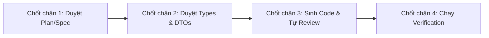

# QUY TRÌNH REVIEW & BỘ PROMPT PHẢN BIỆN (HUMAN-IN-THE-LOOP & ADVERSARIAL REVIEW)
# DỰ ÁN: HỆ THỐNG QUẢN LÝ NHÀ SÁCH (BOOKSTORE MANAGEMENT SYSTEM)

Tài liệu này cung cấp quy trình phối hợp giữa Lập trình viên và AI (Human-in-the-Loop), cùng bộ **Prompt Phản biện (Adversarial Review Prompts)** giúp Antigravity đóng vai **Principal Engineer khắt khe** để rà soát mã nguồn trước khi chốt task hoặc tạo Pull Request.

---

## 1. QUY TRÌNH PHỐI HỢP HUMAN-IN-THE-LOOP (4 CHỐT CHẶN)



1. **Chốt chặn 1 - Duyệt Kế hoạch (Plan Review):**
   - Developer yêu cầu: *"Đọc module X, lập plan chi tiết gồm các file cần tạo/sửa, flow dữ liệu và edge cases"*.
   - Developer xem xét và duyệt Plan trước khi cho phép AI viết code.
2. **Chốt chặn 2 - Duyệt Hợp đồng dữ liệu (Contract Review):**
   - AI định nghĩa xong Type/Interface/DTOs trong `src/types/dtos.ts` hoặc schema.
   - Developer duyệt hợp đồng dữ liệu để đảm bảo không sai lệch nghiệp vụ.
3. **Chốt chặn 3 - Sinh code & AI Tự phản biện (Self-Adversarial Review):**
   - AI sinh code từng file theo checklist.
   - Trước khi báo xong, AI tự kích hoạt vai trò **Principal Engineer** để tự bới vết tìm lỗi.
4. **Chốt chặn 4 - Chạy kiểm thử tự động (Verification):**
   - Chạy lệnh build, type-check (`npm run build` hoặc `tsc --noEmit`), chạy unit tests để chứng minh code chạy tốt.

---

## 2. PROMPT MẪU: ĐÓNG VAI PRINCIPAL ENGINEER KHẮT KHE

Khi bạn (Developer) chuẩn bị hoàn tất một task, hãy gửi prompt sau cho Antigravity:

```markdown
Hãy đóng vai một Principal Engineer khắt khe và khó tính nhất. Hãy review toàn diện đoạn code/tính năng vừa được tạo ra theo 6 tiêu chí cốt lõi của dự án Bookstore Management System:

1. **Ranh giới Kiến trúc & Chiều phụ thuộc:**
   - Có file nào vi phạm Layered Architecture không? (Ví dụ: UI component gọi trực tiếp Supabase client, Model import Service, hoặc circular dependencies).
2. **Strict Typing & Nguyên lý Hướng đối tượng (OOAD/SOLID):**
   - Có xuất hiện bất kỳ kiểu `any`, type assertion vô căn cứ (`as any`), hoặc `@ts-ignore` nào không?
   - Các Entity trong `src/models/` có đảm bảo tính Đóng gói (Encapsulation - private fields, validation trong constructor) hay đang là Anemic Model?
3. **Từ điển nghiệp vụ (Ubiquitous Language):**
   - Tên biến, class, method có chuẩn xác theo `docs/ubiquitous-language.md` không? (Có bị nhầm `Product` thay vì `Book`, `User` thay vì `Customer`, `Order` thay vì `GoodsReceipt` không?).
4. **Xử lý Edge Cases & Rủi ro nghiệp vụ:**
   - Số lượng tồn kho âm, giá tiền âm, chia cho 0, chuỗi rỗng/chỉ chứa khoảng trắng, trùng lặp ISBN, hết hàng giữa chừng khi thanh toán đã được xử lý triệt để chưa?
5. **Hiệu năng & Rò rỉ tài nguyên:**
   - Có re-render thừa trong React không? Có unhandled promise rejection, memory leak, hoặc N+1 queries khi truy vấn Supabase không?
6. **Bảo mật:**
   - Dữ liệu đầu vào từ người dùng đã được sanitize chưa? Có nguy cơ tấn công injection hoặc lộ secret key không?

Hãy chấm điểm mức độ sẵn sàng (Production Ready) trên thang điểm 10 và chỉ ra danh sách các điểm CẦN SỬA GẤP (Critical Issues) nếu có.
```

---

## 3. CHECKLIST ĐÁNH GIÁ NHANH TRƯỚC KHI COMMIT (PRE-COMMIT CHECKLIST)

- [ ] `tsc --noEmit` hoặc `npm run build` chạy thành công không có lỗi type.
- [ ] Mọi thuộc tính trong Entity `BaseEntity` và con của nó đều được đóng gói (`private`/`protected`).
- [ ] Không có file nào trong `src/components/` hoặc `src/app/` import `@supabase/supabase-js`.
- [ ] Mọi async function đều có try/catch hoặc cơ chế xử lý lỗi tường minh.
- [ ] Module-level `README.md` đã được cập nhật nếu có thêm Public API mới.
- [ ] Nếu có thay đổi cấu trúc DB hoặc thư viện cốt lõi, đã tạo file `docs/adr/00X-*.md`.
